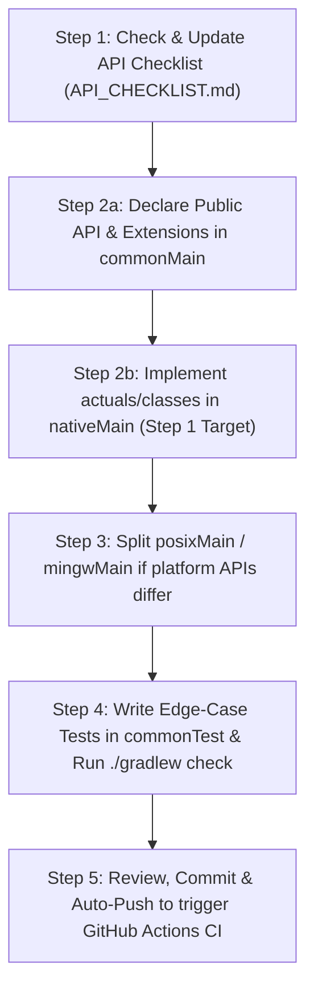

# `jako` Standard API Porting Guidelines & Workflow

This Skill documents the rules, workflow, nullability decision guidelines, behavior parity guarantee with Java 8, and CI requirements for porting Java 8 standard library APIs to `jako` (Kotlin Multiplatform for JVM, Native & Node.js).

---

## 1. Core Principles

1. **Java 8 Target Baseline**:
   - Focus exclusively on **Java 8 API parity**. Do not include APIs introduced in Java 9+ (e.g., `InputStream.transferTo()`, `java.nio.file.Path.of()`).
2. **Strict Signature & Nullability Fidelity**:
   - Every ported class, interface, and method must strictly align with JDK 8 signatures and supertypes.
   - If an API signature or nullability discrepancy against JDK 8 is discovered, fix it directly in place.
3. **`commonMain` Public Declaration Mandate (全量 Public 声明位于 commonMain)**:
   - **CRITICAL RULE**: ALL public API declarations — including `java.*` classes, interfaces, `expect object` / `expect class` declarations, properties, methods, and extension functions — **MUST BE DECLARED IN `commonMain`**.
   - Public APIs MUST NOT be defined solely inside `nativeMain`! If a public API or extension function is declared only in `nativeMain`, multiplatform source code in `commonMain` will fail to resolve it during compilation.
   - `jvmMain` is **EMPTY** — on JVM, the Kotlin compiler resolves `java.*` imports to real JDK classes and stdlib extensions automatically.
4. **Multiplatform Target Roadmap (Native 为第一步，后续扩展 Node.js)**:
   - `nativeMain` (macOS, Linux, Windows MinGW, iOS, watchOS, tvOS) is **Step 1** of target implementation.
   - **Step 2** will add support for Node.js (`jsMain` / `nodeJsMain` / `wasmMain`).
   - Maintaining all public declarations in `commonMain` ensures seamless cross-target compilation when adding Node.js and other targets in the future.
5. **Mandatory Documentation & Decision Rationale**:
   - Document **`[Nullability Decision]`** in code comments whenever mapping Java platform types (`T!`) to explicit Kotlin types (`T` vs `T?`).
6. **Mandatory Unit Tests & Behavior Parity Guarantee with Java (新增功能与修复必须配套单测)**:
   - **CRITICAL RULE**: Every new feature, newly ported class/method, or bug fix **MUST be accompanied by corresponding unit tests** in `commonTest` (or module `test`). Never implement or modify functionality without adding/updating unit tests.
   - Native test results MUST match JDK 8 / Android test results 100%. Running unit tests in `commonTest` automatically tests JVM (`jvmTest`) and Native implementations (`nativeTest`). Both targets must be executed and pass before a task is considered complete.
7. **Kotlin Consumer Perspective & Property Parity (Kotlin 消费方 API 属性对齐)**:
   - Always declare Kotlin properties (e.g., `val absolutePath: String`, `val path: String`) in `commonMain` alongside Java getter methods (`fun getAbsolutePath(): String`).
   - **Rationale**: `jako` is consumed exclusively by Kotlin code. While Kotlin compiler automatically synthesizes properties for Java bytecode on JVM (`file.absolutePath` -> `File.getAbsolutePath()`), it does **NOT** synthesize properties for Kotlin-declared classes on Native/JS.
8. **Direct Implementation of Kotlin Stdlib Extensions in `commonMain` (Kotlin stdlib 扩展直接于 commonMain 实现)**:
   - Kotlin stdlib defines rich extension functions, properties, and operator overloads on Java platform classes across standard library packages (`kotlin.io`, `kotlin.io.path`, `kotlin.concurrent`, `kotlin`, `kotlin.collections`, `kotlin.jvm.optionals`, etc.).
   - **CRITICAL ARCHITECTURAL DECISION**: All these extensions MUST be implemented **directly as concrete functions in `commonMain` under official standard `kotlin.*` package names**.
   - **DO NOT** declare them only in `nativeMain` (which makes them invisible to consumer `commonMain` code).
   - **DO NOT** use `expect`/`actual` boilerplate (since they only invoke ported Java 8 public APIs, they are 100% platform-agnostic pure Kotlin).
   - Standard package names like `kotlin.io` and `kotlin` leverage Kotlin's default auto-imports, matching standard JVM behavior out of the box.
9. **Strict Upstream File Organization Parity (代码文件组织严格对齐上游声明文件)**:
   - **CRITICAL RULE**: Every ported public type or extension function MUST be placed in a source file whose directory and filename strictly align with the upstream JVM (`jdk` / `kotlin-stdlib`) or Android (`AOSP`) declaration file (`SourceFile` attribute in bytecode). **Never bundle unrelated types into a single file** (e.g., never create catch-all files like `IO.kt`, `Net.kt`, `Graphics.kt`, or `OsShims.kt`).
   - **Java & Android Classes (1 Top-Level Public Type Per File)**:
     - `commonMain`: `<package>/<ClassName>.kt` (e.g., `Socket.java` -> `commonMain/kotlin/java/net/Socket.kt`; `Handler.java` -> `commonMain/kotlin/android/os/Handler.kt`).
     - `nonJvmMain` / `nativeMain` / `posixMain` / `mingwMain` / `appleMain` / `linuxMain` / `webMain` / `jsMain` / `wasmJsMain`: `<package>/<ClassName>.<target>.kt` (e.g., `nonJvmMain/kotlin/java/util/ArrayList.nonJvm.kt`, `nativeMain/kotlin/java/lang/Thread.native.kt`, `posixMain/kotlin/java/net/Socket.posix.kt`, `mingwMain/kotlin/java/net/Socket.mingw.kt`, `webMain/kotlin/java/lang/Thread.web.kt`).
     - `jvmMain` (desktop JVM Android shims in `jako-android`): `<package>/<ClassName>.kt` (e.g., `jvmMain/kotlin/android/os/Handler.kt`).
     - Nested/inner types (e.g., `Uri.Builder`, `SharedPreferences.Editor`) must remain inside their enclosing class's file.
   - **Kotlin Stdlib Extensions (`kotlin.*` packages)**:
     - Must match the exact source file name from `kotlin-stdlib` (`JvmMultifileClass` / `SourceFile` metadata), such as `kotlin/io/FileReadWrite.kt`, `kotlin/io/FilePathComponents.kt`, `kotlin/io/FileTreeWalk.kt`, `kotlin/io/Utils.kt`, `kotlin/io/IOStreams.kt`, `kotlin/io/ReadWrite.kt`, `kotlin/text/StringsJVM.kt`, `kotlin/text/RegexExtensionsJVM.kt`, `kotlin/concurrent/Locks.kt`, `kotlin/jvm/optionals/Optionals.kt`, `kotlin/BigIntegers.kt`, `kotlin/BigDecimals.kt`.
   - **Automated Guard**: `JdkSignatureParityTest` and `AndroidSignatureParityTest` automatically verify `SourceFile` parity across `commonMain`, `nonJvmMain`, `nativeMain`, `posixMain`, `mingwMain`, `webMain`, `jsMain`, `wasmJsMain`, and `jvmMain`.
10. **Standardized Exception for Target-Unsupported APIs (目标平台不支持 API 的标准化异常原则)**:
   - **CRITICAL RULE**: When a method on a supported class in `commonMain` cannot be supported on a specific target runtime due to fundamental platform constraints (for example, preemptive shared-memory `java.lang.Thread.start()` on single-threaded JS/Wasm runtimes), **NEVER silently no-op or fake broken semantics**.
   - Always call `com.bennyhuo.jako.unsupportedOnTarget(api, target, reason, alternative)` to throw a standardized `UnsupportedOperationException` with the diagnostic format:
     `[jako] API '<ClassName>.<methodName>(...)' is not supported on target '<Target>': <Reason>. Recommended alternative: <Alternative>.`
   - Every target-unsupported method MUST be documented in `UNSUPPORTED_APIS.md` (Section 4.2) and verified with an explicit unit test in `commonTest`.

---

## 2. Java Behavior & Signature Parity Testing Strategy

To guarantee that Native ported APIs match Java 8 declarations and behavior:

1. **Automated Target JDK Signature, Blacklist & Backward-Compatibility Check (`JdkSignatureParityTest`)**:
   - Located in `jako-stdlib/src/jvmTest/kotlin/jako/test/parity/JdkSignatureParityTest.kt` and executed automatically during `./gradlew check`, `./gradlew checkApiCompatibility`, and Git `pre-commit` hook.
   - Uses `javax.tools.JavaCompiler` with `--release <N>` (default `8`, configurable via `-Pjako.jdkRelease=<N>`) to inspect the exact target JDK symbol table regardless of host JVM version.
   - Verifies that every `expect` declaration in `commonMain` has a matching `actual` declaration in `nativeMain`/`posixMain` with identical supertypes (compensating for `-Xno-check-actual`).
   - Verifies that source file names in `commonMain`, `nativeMain`, `posixMain`, and `mingwMain` strictly match the upstream JDK / `kotlin-stdlib` `SourceFile` attributes (1 class per file).
   - Verifies `commonMain` supertypes, method names/arities, and synthetic properties (`val`/`var`) against the target JDK (`--release <N>`).
   - Verifies 100% accounting of all public classes in tracked JDK packages across `commonMain` (`API_CHECKLIST.md`), Kotlin built-ins, and `UNSUPPORTED_APIS.md`.
   - Verifies backward compatibility against committed API baselines (`api/jako-stdlib.api` and `api/jako-android.api`). Run `./gradlew dumpApiBaseline` when adding new public APIs.

2. **Single Common Test Suite, Dual Target Execution**:
   - Write all behavioral assertions and edge-case tests in `commonTest`.
   - When executing `./gradlew check`:
     - `jvmTest` runs the test suite against **real JDK** classes (since `jvmMain` has no source, `java.*` imports resolve to JDK directly).
     - `nativeTest` runs the SAME test suite against the **Native implementation** in `nativeMain`.
     - If both pass, Native implementation is proven to match JDK 8 behavior!

3. **Edge-Case Parity Checklist**:
   Every API test MUST include edge cases matching JDK 8 behavior:
   - Empty paths `""`, root paths `"/"`, and relative paths (`"."`, `".."`).
   - Non-existent files/directories (checking return values of `length()`, `exists()`, `delete()`, `list()`).
   - Mixed path separators (`/` vs `\`).
   - Exception type matching (e.g. throwing `java.io.FileNotFoundException` on both JVM and Native).

---

## 3. Standard API Porting Workflow



### Step 1: Discover & Register API (`API_CHECKLIST.md`)
- Run `javap -public java.pkg.Class` against JDK 8 to inspect exact method signatures.
- Register all methods in `API_CHECKLIST.md` with status `[ ]`.

### Step 2a: Declare Public APIs & Extensions in `commonMain`
- Declare `expect class` / `expect object` and extension functions in `commonMain` following the **1-class-per-file upstream filename rule**:
  ```kotlin
  // File: commonMain/kotlin/java/io/File.kt (matches upstream java/io/File.java)
  package java.io

  expect open class File(pathname: String) {
      open fun getName(): String
      open fun exists(): Boolean
  }
  ```
  ```kotlin
  // File: commonMain/kotlin/kotlin/io/FileReadWrite.kt (matches upstream kotlin-stdlib SourceFile)
  package kotlin.io

  import java.io.File
  import java.io.FileInputStream
  import java.nio.charset.Charset

  public fun File.readText(charset: Charset = Charsets.UTF_8): String = ...
  ```

### Step 2b: Target Implementation in `nativeMain` (Step 1)
- Implement `actual` class or target implementation directly in `nativeMain` using `<ClassName>.native.kt`:
  ```kotlin
  // File: nativeMain/kotlin/java/io/File.native.kt
  package java.io

  actual open class File actual constructor(pathname: String) {
      actual open fun getName(): String = ...
      actual open fun exists(): Boolean = ...
  }
  ```
- Use `platform.posix.*` (or platform-specific APIs) for C-Interop.
- Encapsulate native pointer allocations inside `memScoped { }`.
- Map `errno` to appropriate `java.io.IOException`.
- Add **`[Nullability Decision]`** comments for all return types and parameters.

### Step 3: Platform Split (if needed)
- If POSIX and Win32 APIs differ, split into `posixMain` and `mingwMain`:
  ```
  posixMain/kotlin/java/io/File.posix.kt   # macOS / Linux / iOS
  mingwMain/kotlin/java/io/File.mingw.kt   # Windows
  ```

### Step 4: `commonTest` Unit Testing
- Write tests in `commonTest` covering normal and edge cases:
  ```kotlin
  // File: commonTest/kotlin/jako/test/io/FileTest.kt
  package jako.test.io

  import java.io.File
  import kotlin.test.Test
  import kotlin.test.assertTrue

  class FileTest {
      @Test
      fun testExists() {
          val file = File("/tmp/test.txt")
          file.writeText("Hello")
          assertTrue(file.exists())
      }
  }
  ```
- Execute local verification:
  ```bash
  ./gradlew check
  ```

### Step 5: Commit & Auto-Push after Review (CI & Future Targets)
- **Default Auto-Push Rule**: Once a feature or change has been reviewed by the user and requested to be committed, **automatically run `git push` immediately after `git commit`** by default without asking for separate push confirmation (unless explicitly instructed not to push).
- Pushing to remote triggers `.github/workflows/ci.yml` matrix (`ubuntu-latest`, `macos-latest`, `windows-latest`).
- Future targets (e.g. `nodeJsMain` / `jsMain`) will implement `actual` declarations for Node.js runtime using Node `fs`, `path`, and `buffer` APIs.

---

## 4. Key Technical Considerations & Potential Gotchas

### A. `java.*` Package Compilation & Empty `jvmJar`
- The `build.gradle.kts` must include `-Xallow-kotlin-package` compiler flag to allow declaring classes in `java.*` and `kotlin.*` packages.
- `@file:Suppress("NO_ACTUAL_FOR_EXPECT")` and `-Xno-check-actual` are used so `commonMain` `expect` declarations under `java.*` and `kotlin.*` packages do not require `actual` classes on JVM.
- **CRITICAL**: `tasks.named<KotlinCompile>("compileKotlinJvm") { setSource(emptyList<File>()) }` MUST be kept in `jako-stdlib/build.gradle.kts` so `compileKotlinJvm` compiles zero sources (`NO-SOURCE`) and `jvmJar` contains **no `.class` files**. On JVM, both `jvmTest` and downstream JVM consumers must resolve all `java.*` and `kotlin.*` symbols directly from the JDK and official `kotlin-stdlib`.

### B. Windows (MinGW) Platform Differences
- POSIX functions like `mkdir(path, mode)` behave differently on MinGW (`_mkdir(path)` without mode parameter) or require Win32 API (`CreateDirectoryW`).
- If POSIX signatures differ on MinGW, split target-specific code into `posixMain` (macOS/Linux) and `mingwMain` (Windows).

### C. Memory & Resource Leak Prevention
- Always wrap C pointer allocations in `memScoped { }`.
- For `InputStream` and `Reader` implementations, use Kotlin `use { }` blocks (via `kotlin.io`) for resource cleanup on Native.

### D. Source Set Hierarchy & Target Roadmap
```
commonMain                                       (Public declarations for ALL targets)
├── jvmMain                                      (Empty for stdlib; desktop shims for android)
└── nonJvmMain                                   (Shared pure-Kotlin actual implementations)
    ├── nativeMain                               (Step 1: Native target implementations)
    │   ├── posixMain                            (macOS / Linux / iOS POSIX)
    │   │   ├── appleMain
    │   │   └── linuxMain
    │   └── mingwMain                            (Windows Win32)
    └── webMain                                  (Step 2: Shared JS & Wasm implementations)
        ├── jsMain                               (Node.js IR target)
        └── wasmJsMain                           (WebAssembly Node.js target)
```

### E. Property Synthesis & Idiomatic Kotlin API Access
- On JVM, Kotlin compiler synthesizes properties (`file.path`) for Java getters (`getPath()`).
- On Native/JS, because classes are defined in Kotlin, Kotlin compiler does **NOT** synthesize properties for `fun getXxx()`.
- Therefore, `commonMain` MUST explicitly declare both property (`val path: String`) and method (`fun getPath(): String`).

### F. Comprehensive Kotlin Stdlib Extension Functions & Operator Overloads Checklist
When porting Java classes across different packages, verify and declare all corresponding Kotlin stdlib extension functions, properties, and operator overloads directly in `commonMain` under official `kotlin.*` packages (never add non-standard extensions that do not exist in JDK 8 or official `kotlin-stdlib`, as `jvmTest` compiles directly against JDK + `kotlin-stdlib`):

1. **`java.io` Package (`package kotlin.io`)**:
   - `InputStream`: `readBytes()`, `copyTo(out: OutputStream, bufferSize: Int)`, `buffered(bufferSize: Int)`, `bufferedReader(charset: Charset)`, `reader(charset: Charset)`, `iterator()`.
   - `OutputStream`: `buffered(bufferSize: Int)`, `bufferedWriter(charset: Charset)`, `writer(charset: Charset)`.
   - `Reader`: `readText()`, `readLines()`, `copyTo(out: Writer, bufferSize: Int)`, `forEachLine(action: (String) -> Unit)`, `useLines(block: (Sequence<String>) -> T)`, `buffered(bufferSize: Int)`, `lineSequence()`.
   - `Writer`: `buffered(bufferSize: Int)`.
   - `File`: `readText()`, `writeText()`, `appendText()`, `readBytes()`, `writeBytes()`, `appendBytes()`, `readLines()`, `forEachLine()`, `useLines()`, `copyTo()`, `copyRecursively()`, `deleteRecursively()`, `walk()`, `walkTopDown()`, `walkBottomUp()`, `relativeTo()`, `relativeToOrSelf()`, `relativeToOrNull()`, `toRelativeString()`, `startsWith()`, `endsWith()`, `resolve()`, `resolveSibling()`, `extension`, `nameWithoutExtension`, `invariantSeparatorsPath`.

2. **`java.nio.file` Package (`package kotlin.io.path`)**:
   - `Path`: `readText()`, `writeText()`, `readBytes()`, `writeBytes()`, `copyTo()`, `deleteRecursively()`, `exists()`, `notExists()`, `isDirectory()`, `isRegularFile()`, `div` operator (`path / "child"`), `extension`, `nameWithoutExtension`.

3. **`java.lang` Package (`package kotlin`)**:
   - `Throwable`: `initCause()`, `suppressed`, `getSuppressed()`.
   - `CharSequence` / `String`: `toByteArray()`, `format()`, `lowercase(Locale)`, `uppercase(Locale)`.

4. **`java.util` & `java.util.concurrent` Package (`package kotlin.concurrent` & `package kotlin.collections`)**:
   - `Enumeration<E>` (`kotlin.collections`): `iterator()`, `toList()`.
   - `Lock` / `ReentrantLock` (`kotlin.concurrent`): `withLock { block }`.
   - `ReentrantReadWriteLock` (`kotlin.concurrent`): `read { block }`, `write { block }`.
   - `Optional<T>` (`kotlin.jvm.optionals`): `getOrNull()`, `getOrDefault()`, `getOrElse()`, `toList()`, `toSet()`, `toCollection()`, `asSequence()`.

5. **`java.math` Package (`package kotlin`)**:
   - `BigInteger`: `+`, `-`, `*`, `/`, `%`, `unaryMinus()`, `inc()`, `dec()`, `shl()`, `shr()`, `ushr()`, `and()`, `or()`, `xor()`, `inv()`, `toBigInteger()`.
   - `BigDecimal`: `+`, `-`, `*`, `/`, `%`, `unaryMinus()`, `inc()`, `dec()`, `toBigDecimal()`.

6. **`java.util.regex` Package (`package kotlin.text`)**:
   - `Pattern.toRegex()`, `Regex.toPattern()`.

- **Mandatory Verification**: Add unit tests in `commonTest` for every implemented extension function to ensure 100% parity on both JVM and Native targets!
