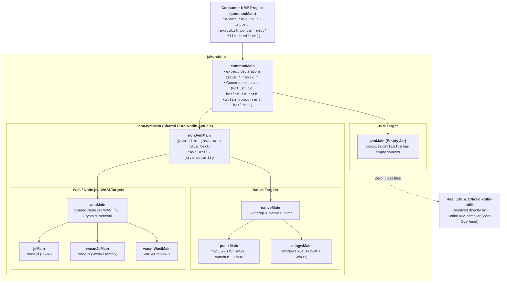

# jako

[English](README.md) | [中文](README_zh.md)

**jako** is an open-source project dedicated to porting and aligning **Java 8 Standard Library APIs** (and core **Android Framework APIs** for non-JVM targets) across Kotlin Multiplatform (**JVM**, **Native**, **Node.js `js`**, **WebAssembly `wasmJs`**, and **`wasmWasi`**).

On non-JVM Kotlin Multiplatform targets (Native, JS, WasmJs, and WasmWasi), standard `java.*` libraries (such as `java.io.File`, `java.net.Socket`, `java.time.*`, `java.nio.*`, `java.security.*`) that Java developers are familiar with are natively unavailable. `jako` bridges this gap by providing POSIX / Win32 C-Interop implementations on Native targets and Node.js / WASI implementations on JS, WasmJs & WasmWasi — all under the real `java.*` package names — so existing JVM libraries can compile and run across Kotlin Multiplatform **without changing a single import statement**.

---

## 🌟 Key Features & Design Principles

1. **100% Behavior Parity with Java 8**
   - Strictly targets Java 8 API baseline (does not include Java 9+ APIs).
   - Unified unit tests written in `commonTest`. Running `./gradlew check` executes:
     - `jvmTest`: Runs tests against real **JDK 8** (JVM target — `jako-stdlib-jvm.jar` ships zero `java.*` classes, so tests compile and run against the real JDK).
     - `nativeTest`: Runs the exact same tests against **Kotlin Native** and C-interop implementations.
     - `jsNodeTest`, `wasmJsNodeTest` & `wasmWasiNodeTest`: Runs the exact same tests on **Node.js (JS IR, WebAssembly JS & WASI)**.
     - Passing tests across all targets guarantees multiplatform parity with JDK 8 behavior.

2. **Zero `java.*` / `android.*` Classpath Pollution on JVM**
   - Unlike `actual typealias` wrapper approaches, `jako` declares `java.*` and `kotlin.*` APIs in `commonMain` for KMP metadata and non-JVM compilation, while `jako-stdlib-jvm.jar` contains **zero `java.*` or `kotlin.*` `.class` files** (only lightweight `com.bennyhuo.jako.annotations.*` metadata).
   - On JVM, the Kotlin compiler resolves all `java.*` and `kotlin.*` symbols directly to the real JDK and official `kotlin-stdlib` — zero runtime overhead, zero indirection, zero classpath pollution. Likewise, `jako-android-jvm.jar` ships **zero `android.*` or `kotlinx.parcelize.*` `.class` files**.

3. **Full Multiplatform Support (Native POSIX/Win32 + Node.js JS/WasmJs + WASI)**
   - **Native**: Supports macOS (`arm64`, `x64`), iOS (`arm64`, `x64`, `simulatorArm64`), tvOS, watchOS, Linux (`x64`, `arm64`), and Windows (`mingwX64`) via C-Interop (`memScoped`) and POSIX `errno` / Win32 error code mapping.
   - **JS & WasmJs (Node.js)**: Supports `js(IR) { nodejs() }` and `wasmJs { nodejs() }` with synchronous filesystem (`node:fs`), process (`node:child_process`), OS/env (`node:os`), cryptography (`node:crypto`), and real OS TCP/UDP/DNS networking (`node:net`, `node:dgram`, `node:dns` via background `worker_threads` + `SharedArrayBuffer`/`Atomics`).
   - **WasmWasi**: Supports `wasmWasi { nodejs() }` with WASI preview1 clocks, CSPRNG (`random_get`), environment variables, and an isolated in-memory POSIX virtual filesystem.
   - **Explicit Runtime Boundaries & `@WebSupport` Diagnostics**: APIs that are fundamentally incompatible with a target runtime (such as preemptive multi-threading `Thread.start()` on single-threaded JS/Wasm, or raw OS sockets on WASI preview1) are checked at compile time by `@WebSupport` and throw a standardized `UnsupportedOperationException` at runtime; see [`UNSUPPORTED_APIS.md`](UNSUPPORTED_APIS.md).

4. **Explicit Nullability Decisions**
   - Clear decisions and documentation for mapping Java platform types (`T!`) to explicit Kotlin types (`T` vs `T?`).

5. **Native Kotlin-stdlib Extensions Support (Zero-Import Parity)**
   - Standard Kotlin-stdlib extension functions on Java types (`kotlin.io`, `kotlin.io.path`, `kotlin.concurrent`, `kotlin.collections`, `kotlin.jvm.optionals`, `kotlin.streams`, and operator overloads in `kotlin`) are implemented directly as concrete functions in `commonMain`.
   - Zero-import convenience: Standard default auto-imports (e.g. `kotlin.io`) work identically on both JVM and Native.

---

## 🚀 Getting Started

Ensure `mavenCentral()` is included in `settings.gradle.kts` (including inside `pluginManagement` if applying the `com.bennyhuo.jako` Gradle plugin):

```kotlin
// settings.gradle.kts
pluginManagement {
    repositories {
        mavenCentral()
        gradlePluginPortal()
    }
}
```

Add `jako-stdlib` to `commonMain` in `build.gradle.kts`. If you are porting Android code (`android.*`, `org.json`, `@Parcelize`) to **non-JVM** targets (Native, JS, WasmJs, WasmWasi), add `jako-android` to your non-JVM source set (or `commonMain` for pure non-JVM KMP modules; `jako-android` intentionally provides no `android.*` runtime classes on desktop JVM):

```kotlin
kotlin {
    sourceSets {
        commonMain.dependencies {
            implementation("com.bennyhuo.jako:jako-stdlib:1.0.0")
        }
        // For non-JVM targets (Native, JS, WasmJs, WasmWasi) using Android Framework APIs:
        val nonJvmMain by creating {
            dependsOn(commonMain.get())
            dependencies {
                implementation("com.bennyhuo.jako:jako-android:1.0.0")
            }
        }
    }
}
```

### Initializing `jako-android` on Non-JVM Targets (Optional)

For Android APIs that depend on application environment or directory layout (`Context`, `Application`, `AssetManager`, `Resources`, `PackageManager`, `Environment`), `jako-android` works out-of-the-box using OS-standard persistent directories (`~/Library/Application Support` on macOS/iOS, XDG Base Directory on Linux, `%LOCALAPPDATA%` on Windows) and automatic multi-level `assets/` & `res/` discovery.

You can also explicitly configure metadata, directories, and resources at startup via `JakoApplication.init`:

```kotlin
import com.bennyhuo.jako.JakoApplication
import com.bennyhuo.jako.init
import java.io.File

JakoApplication.init {
    packageName = "com.example.mykmpapp"
    versionName = "1.2.0"
    versionCode = 120
    assetsDir = File("./app-assets")
    resourcesDir = File("./app-res")
    putMetaData("channel", "desktop")
    registerStringResource(0x7f010001, "app_name", "My KMP App")
}

val context = JakoApplication.applicationContext
```

### Gradle & Compiler Plugin: `@Synchronized`, `@Parcelize`, `@WebSupport` & `R.xx.yy` Generation

Apply the `com.bennyhuo.jako` Gradle plugin (built against Kotlin `2.4.x` K2 FIR/IR) in `build.gradle.kts` to:
1. **Cross-Platform `@Synchronized`**: Use `import kotlin.jvm.Synchronized` directly in `commonMain`, Native, JS, and Wasm with full reentrant monitor lock semantics (`Thread.holdsLock`, `Object.wait`/`notify`, and interoperability with `synchronized(lock) { ... }`).
2. **Cross-Platform `@Parcelize`**: Synthesizes `Parcelable` implementations (`describeContents`, `writeToParcel`, nested `CREATOR`) across Native, JS, WasmJs, and WasmWasi. If the official `org.jetbrains.kotlin.plugin.parcelize` plugin is also applied in a hybrid Android + KMP module, `com.bennyhuo.jako` automatically yields to the official plugin on Android/JVM compilations.
3. **Compile-Time `@WebSupport` Diagnostics**: Reports compile-time warnings (or errors via `webSupportSeverity.set("error")`) when JS/Wasm code calls APIs unsupported on the configured `WebRuntime` (`NODE_JS`, `WASI`, `BROWSER`).
4. **Compile-Time `R` Resource Class**: Generates `R.string.*`, `R.dimen.*`, `R.raw.*`, `R.integer.*`, `R.bool.*`, `R.color.*`, `R.array.*` for `commonMain` when `res/values/*.xml` or `res/raw/*` files are present:

```kotlin
plugins {
    kotlin("multiplatform") version "2.4.21"
    id("com.bennyhuo.jako") version "1.0.0"
}

jako {
    packageName.set("com.example.mykmpapp") // Required when generating R.kt from res/
    webSupportSeverity.set("warning")       // "warning" (default), "error", or "none"
}
```

### Dev, release candidate, and stable versions

`VERSION_NAME` in `gradle.properties` is the release line (currently `1.0.0`). Published artifacts are immutable Maven Central releases, not snapshots. Gradle orders them as `1.0.0-dev-N` < `1.0.0-rc-N` < `1.0.0`.

| When | Version | How |
|---|---|---|
| CI passes on `main` | `1.0.0-dev-1`, `1.0.0-dev-2`, … | Automatic. Each publish takes the next number. |
| `release` or `release/*` | `1.0.0-rc-1`, then `1.0.0` | Push tag `v1.0.0-rc-1` or `v1.0.0`. |

A dev publish starts after CI on `main` succeeds. If newer commits are already on `main`, the older run is skipped, so a burst of pushes produces one dev version for the latest commit. **Publish Dev** can also be started by hand from `main`.

Pushing `v1.0.0-rc-1` or `v1.0.0` publishes that exact version. The tag's `X.Y.Z` must match `VERSION_NAME` on the tagged commit, and that commit must be on `release` or `release/*`. A `v1.0.0-dev-N` tag pointing at `main` publishes that dev version too. Tags created by the automatic dev publish do not start another publish. **Publish** in Actions, run from a release branch, still chooses the next rc or final number and pushes the tag for you.

`mavenCentral()` is enough; there is no snapshot repository.

```kotlin
kotlin {
    sourceSets {
        commonMain.dependencies {
            // Pin a dev build, or use 1.0.0-dev-+ to follow the newest one.
            implementation("com.bennyhuo.jako:jako-stdlib:1.0.0-dev-1")
            implementation("com.bennyhuo.jako:jako-android:1.0.0-dev-1")
        }
    }
}
```

The Gradle plugin uses the same version: `id("com.bennyhuo.jako") version "1.0.0-dev-1"`. Gradle caches a dynamic version such as `1.0.0-dev-+` for 24 hours.

When cutting the release branch, bump `VERSION_NAME` on `main` if `main` will keep moving (for example to `1.1.0`, which publishes `1.1.0-dev-1`). Otherwise bump it after `1.0.0` is published. Dev builds of a version that already has a final tag are rejected.

---

## 🎯 Status & Coverage

- **Zero-Dependency Standard Library**: `jako-stdlib` is published as an independent, zero-dependency multiplatform library.
- **Package-by-Package Tracking**: All ported Java 8 packages and Kotlin-stdlib extensions are tracked in [`API_CHECKLIST.md`](API_CHECKLIST.md), with 100% public class unit test coverage tracked in [`TEST_COVERAGE.md`](TEST_COVERAGE.md) and target runtime boundaries documented in [`UNSUPPORTED_APIS.md`](UNSUPPORTED_APIS.md).
- **100% Behavioral & Signature Parity**: Multi-target behavioral tests (`commonTest`) and automated JDK reflection parity checks (`JdkSignatureParityTest`) run against real JDK, Kotlin Native, Node.js (`js`), and WebAssembly (`wasmJs` & `wasmWasi`) implementations.

| Layer | Component | Status |
|:---|:---|:---|
| **jako-stdlib** | Core `java.*` / `javax.*` APIs for Native, JS, WasmJs & WasmWasi | ✅ 631 public types (527 core classes, 100% actionable test coverage); see [`API_CHECKLIST.md`](API_CHECKLIST.md) & [`TEST_COVERAGE.md`](TEST_COVERAGE.md) |
| **jako-android** | Non-JVM `android.*`, `org.json`, `org.xmlpull.v1` & `@Parcelize` APIs | ✅ 90 public types (100% test coverage): `android.app`, `android.content` (`res`, `pm`), `android.util`, `android.text`, `android.net`, `android.os`, `android.graphics`, `android.webkit`, `android.preference`, `org.json`, `org.xmlpull.v1` & `JakoApplication.init`; see [`ANDROID_API_CHECKLIST.md`](ANDROID_API_CHECKLIST.md) |
| **jako-compiler-plugin** | K2 FIR + IR Kotlin Compiler Plugin | ✅ Enables `@Synchronized`, cross-platform `@Parcelize`, and `@WebSupport` compile-time checks |
| **jako-gradle-plugin** | Unified Gradle plugin (`com.bennyhuo.jako`) | ✅ Wires `jako-compiler-plugin` and generates compile-time `R.kt` from `res/` |
| **Kotlin Extensions** | Official `kotlin.*` extensions for Java APIs | ✅ Concrete implementations in `commonMain` under official `kotlin.*` packages |
| **sample** | Standalone KMP Sample Project | ✅ Demonstrates `jako-stdlib`, `jako-android` & `jako-gradle-plugin` across JVM, Native, JS, WasmJs & WasmWasi via `includeBuild("../")` |

---

## 🏗️ Architecture



Public Java APIs are declared as `expect` in `commonMain`. `compileKotlinJvm` has empty sources so `jvmJar` contains no compiled classes and JVM consumers resolve everything directly to the real JDK and `kotlin-stdlib`. Native targets provide matching `actual` implementations under the same `java.*` packages. Kotlin-stdlib extension functions (e.g., `File.readText()`, `Path / "child"`, `Lock.withLock`) are implemented directly as concrete functions in `commonMain` under official `kotlin.*` packages.

---

## 🛠️ Build & Test

### Requirements
- JDK 17+ (for Gradle builds)
- Kotlin Multiplatform cross-compilation toolchain

### Run All Tests
```bash
# Build and run tests across JVM and supported Native targets
./gradlew check
```

---

## 📄 License & Third-Party Notices

`jako` is released under the [MIT License](LICENSE).

Third-party notices, bundled component attributions, and upstream API license texts are documented in [`NOTICE`](NOTICE) and the [`licenses/`](licenses/) directory:

- **JetBrains Kotlin (`kotlin-parcelize-compiler`, `kotlin-parcelize-runtime`, `kotlin-stdlib` extension signatures)**: `jako-compiler-plugin` bundles compiled Parcelize FIR/IR classes from JetBrains Kotlin, and `jako-stdlib` / `jako-android` align with official Kotlin multiplatform extension and `@Parcelize` signatures under the [Apache License 2.0](licenses/APACHE-2.0.txt).
- **Android Open Source Project (AOSP) & `org.json` APIs**: `jako-android` provides independent Kotlin Multiplatform implementations aligned with Android API 29 (`android.*`) and AOSP's clean-room `org.json` public signatures under the [Apache License 2.0](licenses/APACHE-2.0.txt).
- **XMLPull v1 API (`org.xmlpull.v1`)**: Independent Kotlin Multiplatform implementation of the [Public Domain](licenses/XMLPULL-PUBLIC-DOMAIN.txt) XMLPull v1 specification (`http://www.xmlpull.org/`).
- **Java SE 8 Standard Library APIs (`java.*`, `javax.*`)**: `jako-stdlib` is an independent, clean-room Kotlin Multiplatform implementation aligned with Java SE 8 API signatures; no OpenJDK or Oracle JDK source code or bytecode is copied or redistributed.
- **Host Runtime Libraries (Not Bundled)**: Native targets link dynamically against system [`zlib`](licenses/ZLIB.txt), and Linux/Windows `javax.net.ssl` optionally loads host `OpenSSL` (`3.x` [Apache-2.0](licenses/APACHE-2.0.txt) / `1.1.x` [OpenSSL License](licenses/OPENSSL-1.1.txt)) dynamically at runtime when present.

