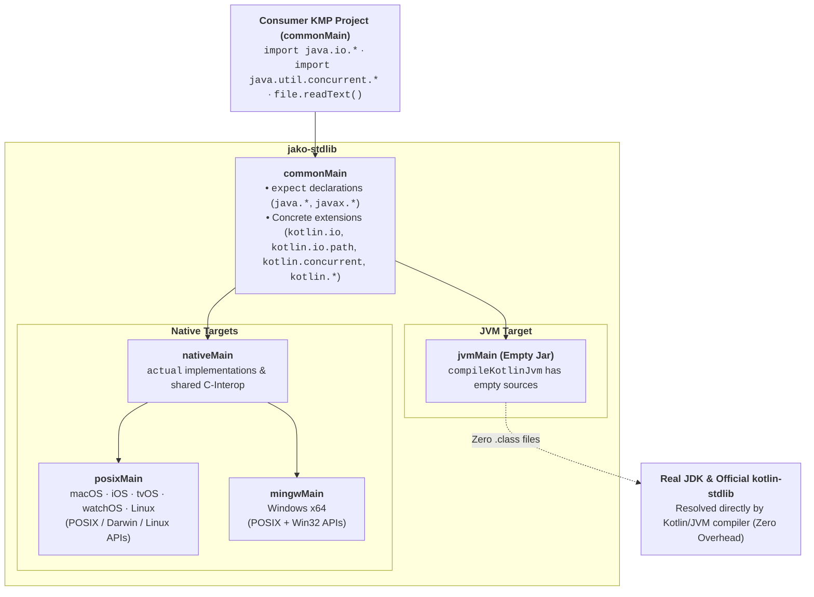

# jako

[English](README.md) | [中文](README_zh.md)

**jako** is an open-source project dedicated to porting and aligning **Java 8 Standard Library APIs** for Kotlin Multiplatform (JVM & Native).

On Kotlin Multiplatform Native targets, many standard `java.*` libraries (such as `java.io.File`) that Java developers are familiar with are natively unavailable. `jako` bridges this gap by providing C-Interop (POSIX / Win32) implementations on Native targets — all under the real `java.*` package names — so existing JVM libraries can compile and run on Kotlin Native **without changing a single import statement**.

---

## 🌟 Key Features & Design Principles

1. **100% Behavior Parity with Java 8**
   - Strictly targets Java 8 API baseline (does not include Java 9+ APIs).
   - Unified unit tests written in `commonTest`. Running `./gradlew check` executes:
     - `jvmTest`: Runs tests against real **JDK 8** (JVM target — `compileKotlinJvm` is empty, tests compile against the real JDK classes).
     - `nativeTest`: Runs the exact same tests against **Kotlin Native** and C-interop implementations.
     - Passing tests on both targets guarantees Native parity with JDK 8 behavior.

2. **Zero-Overhead on JVM (Empty `jvmJar`)**
   - Unlike `actual typealias` wrapper approaches, `jako` declares `java.*` and `kotlin.*` APIs in `commonMain` for KMP metadata and Native compilation, while configuring `compileKotlinJvm` with empty sources (`setSource(emptyList())`).
   - On JVM, the Kotlin compiler resolves all `java.*` and `kotlin.*` symbols directly to the real JDK and official `kotlin-stdlib`, and `jvmJar` contains **no `.class` files** — zero runtime overhead, zero indirection, zero classpath pollution.

3. **Cross-Platform Native Support (POSIX & Win32)**
   - Supports macOS (`arm64`, `x64`), iOS (`arm64`, `x64`, `simulatorArm64`), tvOS, watchOS, Linux (`x64`, `arm64`), and Windows (`mingwX64`).
   - C-Interop wrappers with strict memory management (`memScoped`) and POSIX `errno` / Win32 error code mapping.

4. **Explicit Nullability Decisions**
   - Clear decisions and documentation for mapping Java platform types (`T!`) to explicit Kotlin types (`T` vs `T?`).

5. **Native Kotlin-stdlib Extensions Support (Zero-Import Parity)**
   - Standard Kotlin-stdlib extension functions on Java types (`kotlin.io`, `kotlin.io.path`, `kotlin.concurrent`, `kotlin.collections`, `kotlin.jvm.optionals`, `kotlin.streams`, and operator overloads in `kotlin`) are implemented directly as concrete functions in `commonMain`.
   - Zero-import convenience: Standard default auto-imports (e.g. `kotlin.io`) work identically on both JVM and Native.

---

## 🚀 Getting Started

Add `jako-stdlib` (or `jako-android` if porting Android libraries with `android.*` APIs) to your `commonMain` dependencies in `build.gradle.kts`:

```kotlin
kotlin {
    sourceSets {
        commonMain.dependencies {
            implementation("com.bennyhuo.jako:jako-stdlib:1.0.0")
            // Optional: Android Framework APIs (android.app, android.content, android.util, android.os, android.net, android.text, android.graphics, org.json, org.xmlpull.v1)
            implementation("com.bennyhuo.jako:jako-android:1.0.0")
        }
    }
}
```

### Initializing `jako-android` on PC / Native (Optional)

For Android APIs that depend on application environment or directory layout (`Context`, `Application`, `AssetManager`, `Resources`, `PackageManager`, `Environment`), `jako-android` works out-of-the-box using OS-standard persistent directories (`~/Library/Application Support` on macOS/iOS, XDG Base Directory on Linux, `%LOCALAPPDATA%` on Windows) and automatic multi-level `assets/` & `res/` discovery.

You can also explicitly configure metadata, directories, and resources at startup via `JakoApplication.init`:

```kotlin
import com.bennyhuo.jako.JakoApplication
import com.bennyhuo.jako.init
import java.io.File

JakoApplication.init {
    packageName = "com.example.mykmpapp"
    versionName = "1.2.0"
    versionCode = 120
    assetsDir = File("./app-assets")
    resourcesDir = File("./app-res")
    putMetaData("channel", "desktop")
    registerStringResource(0x7f010001, "app_name", "My KMP App")
}

val context = JakoApplication.applicationContext
```

### Gradle Plugin: `@Synchronized` KCP & Compile-Time `R.xx.yy` Generation

Apply the `com.bennyhuo.jako` Gradle plugin in `build.gradle.kts` to:
1. **Automatically wire the Jako Kotlin Compiler Plugin (`jako-compiler-plugin`)**, enabling `@Synchronized` across `commonMain` and Kotlin/Native with full monitor lock semantics (`Thread.holdsLock`, `Object.wait`/`notify`, and interoperability with `synchronized(lock) { ... }`).
2. **Generate a strongly-typed `R` class** (`R.string.*`, `R.dimen.*`, `R.raw.*`, `R.integer.*`, `R.bool.*`, `R.color.*`, `R.array.*`) for `commonMain` when `res/values/*.xml` or `res/raw/*` files are present, using deterministic resource IDs matching `Resources` at runtime:

```kotlin
plugins {
    kotlin("multiplatform")
    id("com.bennyhuo.jako") version "1.0.0"
}

// Optional if only using @Synchronized without a res/ directory;
// required when generating R.xx.yy from res/
jako {
    packageName.set("com.example.mykmpapp")
}
```

### Using Snapshot Releases (Daily Builds)

Snapshot builds are published daily to the Central Portal Snapshots repository. To use the latest `-SNAPSHOT` version, add the snapshot repository to your `settings.gradle.kts` (or `build.gradle.kts`):

```kotlin
repositories {
    mavenCentral()
    maven("https://central.sonatype.com/repository/maven-snapshots/") {
        mavenContent {
            snapshotsOnly()
        }
    }
}
```

Then declare the `-SNAPSHOT` dependencies in `build.gradle.kts`:

```kotlin
kotlin {
    sourceSets {
        commonMain.dependencies {
            implementation("com.bennyhuo.jako:jako-stdlib:1.0.0-SNAPSHOT")
            // Optional: Android Framework APIs
            implementation("com.bennyhuo.jako:jako-android:1.0.0-SNAPSHOT")
        }
    }
}
```

---

## 🎯 Status & Coverage

- **Zero-Dependency Standard Library**: `jako-stdlib` is published as an independent, zero-dependency multiplatform library.
- **Package-by-Package Tracking**: All ported Java 8 packages and Kotlin-stdlib extensions are tracked in [`API_CHECKLIST.md`](API_CHECKLIST.md).
- **100% Behavioral & Signature Parity**: Dual-target behavioral tests (`commonTest`) and automated JDK reflection parity checks (`JdkSignatureParityTest`) run against both real JDK and Kotlin Native implementations.

| Layer | Component | Status |
|:---|:---|:---|
| **jako-stdlib** | Core `java.*` / `javax.*` APIs for Native | ✅ 577 classes & interfaces implemented; see [`API_CHECKLIST.md`](API_CHECKLIST.md) |
| **jako-android** | Core `android.*`, `org.json` & `org.xmlpull.v1` APIs for Native | ✅ `android.app`, `android.content` (`res`, `pm`), `android.util`, `android.text`, `android.net`, `android.os`, `android.graphics`, `android.webkit`, `android.preference`, `org.json`, `org.xmlpull.v1` & `JakoApplication.init`; see [`ANDROID_API_CHECKLIST.md`](ANDROID_API_CHECKLIST.md) |
| **jako-compiler-plugin** | K2 FIR + IR Kotlin Compiler Plugin | ✅ Enables `@Synchronized` in `commonMain` & Native with reentrant monitor locks |
| **jako-gradle-plugin** | Unified Gradle plugin (`com.bennyhuo.jako`) | ✅ Wires `jako-compiler-plugin` (`@Synchronized`) and generates compile-time `R.kt` from `res/` |
| **Kotlin Extensions** | Official `kotlin.*` extensions for Java APIs | ✅ Concrete implementations in `commonMain` under official `kotlin.*` packages |
| **sample** | Standalone KMP Sample Project | ✅ Demonstrates `jako-stdlib`, `jako-android` & `jako-gradle-plugin` across JVM & Native via `includeBuild("../")` |

---

## 🏗️ Architecture



Public Java APIs are declared as `expect` in `commonMain`. `compileKotlinJvm` has empty sources so `jvmJar` contains no compiled classes and JVM consumers resolve everything directly to the real JDK and `kotlin-stdlib`. Native targets provide matching `actual` implementations under the same `java.*` packages. Kotlin-stdlib extension functions (e.g., `File.readText()`, `Path / "child"`, `Lock.withLock`) are implemented directly as concrete functions in `commonMain` under official `kotlin.*` packages.

---

## 🛠️ Build & Test

### Requirements
- JDK 17+ (for Gradle builds)
- Kotlin Multiplatform cross-compilation toolchain

### Run All Tests
```bash
# Build and run tests across JVM and supported Native targets
./gradlew check
```

---

## 📄 License

[MIT License](LICENSE)

