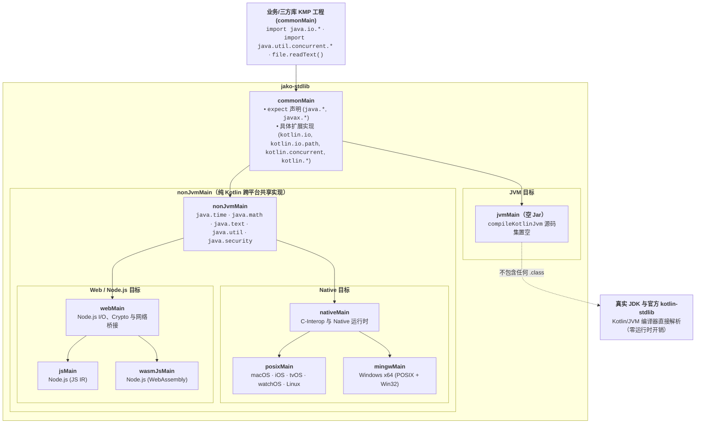

# jako

[English](README.md) | [中文](README_zh.md)

**jako** 是一个开源项目，致力于将 **Java 8 标准库 API** 移植到 Kotlin Multiplatform（**JVM**、**Native**、**Node.js `js`** 与 **WebAssembly `wasmJs`**）。

在非 JVM 的 Kotlin Multiplatform 目标平台（Native、JS 与 WasmJs）上，Java 开发者熟悉的 `java.*` 标准库（如 `java.io.File`、`java.net.Socket`、`java.time.*`、`java.nio.*`、`java.security.*`）无法直接使用。`jako` 通过在 Native 端提供 C-Interop（POSIX / Win32）实现、在 JS 与 WasmJs（Node.js）端提供底层 `node:fs`、`node:net`、`node:dgram`、`node:dns`、`node:crypto`、`node:child_process` 与 `worker_threads` + `SharedArrayBuffer`/`Atomics` 桥接实现来弥补这一缺口——所有实现都使用真正的 `java.*` 包名——因此现有的 JVM 库**无需修改任何 import 语句**即可在 Kotlin Multiplatform 全平台编译运行。

---

## 🌟 核心特性与设计原则

1. **与 Java 8 100% 行为一致**
   - 严格以 Java 8 API 为基线（不包含 Java 9+ 的 API）。
   - 统一在 `commonTest` 中编写测试。执行 `./gradlew check` 时：
     - `jvmTest`：使用真正的 **JDK 8** 执行测试（JVM 端 `compileKotlinJvm` 无源码，直接使用 JDK 类）。
     - `nativeTest`：使用 **Kotlin Native** 的 C-interop 实现执行相同测试。
     - `jsNodeTest` 与 `wasmJsNodeTest`：在 **Node.js（JS IR 与 WebAssembly）** 上执行相同测试。
     - 全平台通过即保证各目标平台实现与 JDK 8 行为完全一致。

2. **JVM 零开销（空 `jvmJar`）**
   - `jako` 在 `commonMain` 中声明 `java.*` 与 `kotlin.*` API 供 KMP 元数据与非 JVM 编译使用，同时将 `compileKotlinJvm` 的源码集设为空（`setSource(emptyList())`）。
   - 在 JVM 上，Kotlin 编译器自动将所有 `java.*` 与 `kotlin.*` 解析为真正的 JDK 类与官方 `kotlin-stdlib`，最终生成的 `jvmJar` **不包含任何 `.class` 字节码文件**——零运行时开销，零间接调用，零 Classpath 污染。

3. **全平台支持（Native POSIX/Win32 + Node.js JS/WasmJs）**
   - **Native**：支持 macOS（`arm64`、`x64`）、iOS（`arm64`、`x64`、`simulatorArm64`）、tvOS、watchOS、Linux（`x64`、`arm64`）和 Windows（`mingwX64`），使用 `memScoped` 严格管理 C 内存并映射 POSIX `errno` / Win32 错误码。
   - **JS & WasmJs (Node.js)**：支持 `js(IR) { nodejs() }` 与 `wasmJs { nodejs() }`，接入真实文件系统（`node:fs`）、子进程（`node:child_process`）、系统环境（`node:os`）、密码学（`node:crypto`）以及真实操作系统 TCP/UDP/DNS 网络栈（基于后台 `worker_threads` + `SharedArrayBuffer`/`Atomics` 桥接 `node:net`、`node:dgram`、`node:dns`）。
   - **明确的运行时能力边界**：对于受限于目标平台底层运行时的 API（如单线程 JS/WasmJs 上的抢占式多线程 `Thread.start()`），在调用时统一抛出标准化的 `UnsupportedOperationException` 并给出替代建议，详见 [`UNSUPPORTED_APIS.md`](UNSUPPORTED_APIS.md)。

4. **显式的可空性决策**
   - 为 Java 平台类型（`T!`）到 Kotlin 显式类型（`T` vs `T?`）的映射提供清晰的决策和文档。

5. **原生 Kotlin-stdlib 扩展支持（零导包对齐）**
   - Kotlin 标准库在 Java 类型上的扩展（`kotlin.io`、`kotlin.io.path`、`kotlin.concurrent`、`kotlin.collections`、`kotlin.jvm.optionals`、`kotlin.streams` 以及 `kotlin` 中的操作符重载）全部作为具体函数直接在 `commonMain` 中实现。
   - 零导包开销：标准默认导入（如 `kotlin.io`）在 JVM 与 Native 上体验完全一致。

---

## 🚀 快速接入

在 `build.gradle.kts` 的 `commonMain` 依赖中添加 `jako-stdlib`（如果移植的库还使用了 `android.*` API，可同时添加 `jako-android`）：

```kotlin
kotlin {
    sourceSets {
        commonMain.dependencies {
            implementation("com.bennyhuo.jako:jako-stdlib:1.0.0")
            // 可选：Android Framework 核心 API 支持 (android.app, android.content, android.util, android.os, android.net, android.text, android.graphics, org.json, org.xmlpull.v1)
            implementation("com.bennyhuo.jako:jako-android:1.0.0")
        }
    }
}
```

### 在 PC / Native 端初始化 `jako-android`（可选）

对于依赖运行环境或目录结构的 Android API（如 `Context`、`Application`、`AssetManager`、`Resources`、`PackageManager`、`Environment`），`jako-android` 默认遵循各操作系统标准持久化目录规范（macOS/iOS 使用 `~/Library/Application Support`，Linux 使用 XDG 规范目录，Windows 使用 `%LOCALAPPDATA%`）以及多级 `assets/` 与 `res/` 目录自动探测机制，开箱即用。

同时，开发者也可以在程序启动时通过 `JakoApplication.init` 显式配置应用信息、资源目录与预注册资源：

```kotlin
import com.bennyhuo.jako.JakoApplication
import com.bennyhuo.jako.init
import java.io.File

JakoApplication.init {
    packageName = "com.example.mykmpapp"
    versionName = "1.2.0"
    versionCode = 120
    assetsDir = File("./app-assets")
    resourcesDir = File("./app-res")
    putMetaData("channel", "desktop")
    registerStringResource(0x7f010001, "app_name", "My KMP App")
}

val context = JakoApplication.applicationContext
```

### Gradle 插件：`@Synchronized` 编译器插件与 `R.xx.yy` 资源索引生成

在 `build.gradle.kts` 中应用 `com.bennyhuo.jako` Gradle 插件，即可一站式启用：
1. **自动挂载 Jako Kotlin 编译器插件（`jako-compiler-plugin`）**：支持在 `commonMain` 与 Kotlin/Native 中直接使用 `@Synchronized` 注解，底层与 `synchronized(lock) { ... }`、`Thread.holdsLock`、`Object.wait`/`notify` 共享同一可重入对象监视器锁。
2. **编译期生成强类型 `R` 类**：当工程包含 `res/values/*.xml` 与 `res/raw/*` 资源目录时，自动为 `commonMain` 生成 `R.string.*`、`R.dimen.*`、`R.raw.*`、`R.integer.*`、`R.bool.*`、`R.color.*`、`R.array.*`，其确定性资源 ID 与运行时 `Resources` 完全对齐：

```kotlin
plugins {
    kotlin("multiplatform")
    id("com.bennyhuo.jako") version "1.0.0"
}

// 若仅使用 @Synchronized 且无 res/ 目录则无需配置；
// 若存在 res/ 目录需生成 R.xx.yy，请指定 packageName：
jako {
    packageName.set("com.example.mykmpapp")
}
```

### 使用 Snapshot 快照版本（每日构建）

`jako` 每天自动构建并向 Maven Central Portal 快照仓库发布最新 Snapshot 版本。如需使用 `-SNAPSHOT` 版本，请在 `settings.gradle.kts`（或 `build.gradle.kts`）中添加快照仓库：

```kotlin
repositories {
    mavenCentral()
    maven("https://central.sonatype.com/repository/maven-snapshots/") {
        mavenContent {
            snapshotsOnly()
        }
    }
}
```

随后在 `build.gradle.kts` 中引入 `-SNAPSHOT` 依赖：

```kotlin
kotlin {
    sourceSets {
        commonMain.dependencies {
            implementation("com.bennyhuo.jako:jako-stdlib:1.0.0-SNAPSHOT")
            // 可选：Android Framework 核心 API 支持
            implementation("com.bennyhuo.jako:jako-android:1.0.0-SNAPSHOT")
        }
    }
}
```

---

## 🎯 现状与覆盖度

- **零依赖独立标准库**：`jako-stdlib` 作为独立的零依赖多平台库发布。
- **以包名为维度的清单追踪**：所有已移植的 Java 8 核心包及 Kotlin-stdlib 扩展均在 [`API_CHECKLIST.md`](API_CHECKLIST.md) 中登记追踪，100% 公开类单测覆盖率账本见 [`TEST_COVERAGE.md`](TEST_COVERAGE.md)，目标平台运行时能力边界见 [`UNSUPPORTED_APIS.md`](UNSUPPORTED_APIS.md)。
- **100% 行为与签名一致**：通过全平台行为单测（`commonTest`）与自动化 JDK 反射签名检查（`JdkSignatureParityTest`）保证 Native、JS 与 WasmJs 实现同真实 JDK 行为和继承结构一致。

| 层级 | 组件 | 状态 |
|:---|:---|:---|
| **jako-stdlib** | 核心 `java.*` / `javax.*` API（Native、JS & WasmJs） | ✅ 611 个可测公开类与接口（100% 单测覆盖），详情见 [`API_CHECKLIST.md`](API_CHECKLIST.md) 与 [`TEST_COVERAGE.md`](TEST_COVERAGE.md) |
| **jako-android** | 核心 `android.*`、`org.json` 与 `org.xmlpull.v1` API | ✅ 覆盖 `android.app`、`android.content`（含 `res`、`pm`）、`android.util`、`android.text`、`android.net`、`android.os`、`android.graphics`、`android.webkit`、`android.preference`、`org.json`、`org.xmlpull.v1` 及 `JakoApplication.init`，详情见 [`ANDROID_API_CHECKLIST.md`](ANDROID_API_CHECKLIST.md) |
| **jako-compiler-plugin** | K2 FIR + IR Kotlin 编译器插件 | ✅ 支持在 `commonMain`、Native、JS 与 WasmJs 中使用 `@Synchronized` 可重入对象监视器锁 |
| **jako-gradle-plugin** | 统一 Gradle 插件（`com.bennyhuo.jako`） | ✅ 自动挂载 `jako-compiler-plugin`（`@Synchronized`）并扫描 `res/` 生成编译期 `R.kt` |
| **Kotlin 扩展** | Java API 的官方 `kotlin.*` 扩展支持 | ✅ 直接在 `commonMain` 的官方 `kotlin.*` 包下提供具体实现 |
| **sample** | 独立 Gradle KMP 示例工程 | ✅ 通过 `includeBuild("../")` 依赖 `jako-stdlib`、`jako-android` 与 `jako-gradle-plugin`，展示跨 JVM、Native、JS 与 WasmJs 实际使用场景 |

---

## 🏗️ 架构



公开 Java API 在 `commonMain` 用 `expect` 声明。`compileKotlinJvm` 源码集设为空，因此 `jvmJar` 不包含任何编译产物，JVM 端直接解析到真实 JDK 与官方 `kotlin-stdlib`。Native 在同样的 `java.*` 包下提供对应的 `actual` 实现。Kotlin-stdlib 扩展函数（如 `File.readText()`、`Path / "child"`、`Lock.withLock`）直接作为具体函数在 `commonMain` 的官方 `kotlin.*` 包下实现。

---

## 🛠️ 构建与测试

### 环境要求
- JDK 17+（用于 Gradle 构建）
- Kotlin Multiplatform 交叉编译工具链

### 运行所有测试
```bash
# 在 JVM 和支持的 Native 目标上构建并运行测试
./gradlew check
```

---

## 📄 许可证

[MIT License](LICENSE)

