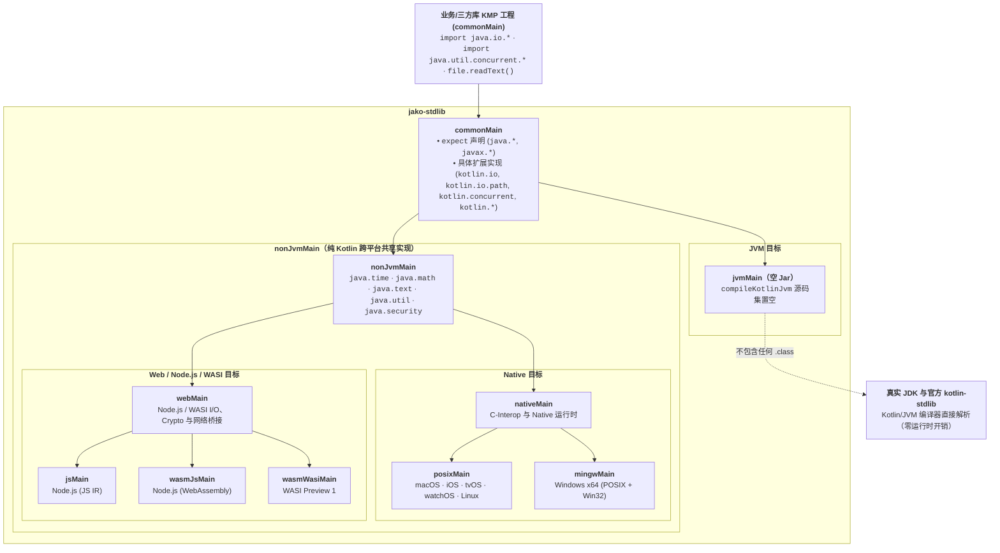

# jako

[English](README.md) | [中文](README_zh.md)

**jako** 是一个开源项目，致力于将 **Java 8 标准库 API**（以及面向非 JVM 目标平台的 **Android 核心 API**）移植到 Kotlin Multiplatform（**JVM**、**Native**、**Node.js `js`**、**WebAssembly `wasmJs`** 与 **`wasmWasi`**）。

在非 JVM 的 Kotlin Multiplatform 目标平台（Native、JS、WasmJs 与 WasmWasi）上，Java 开发者熟悉的 `java.*` 标准库（如 `java.io.File`、`java.net.Socket`、`java.time.*`、`java.nio.*`、`java.security.*`）无法直接使用。`jako` 通过在 Native 端提供 C-Interop（POSIX / Win32）实现、在 JS / WasmJs / WasmWasi 端提供底层 Node.js 与 WASI 桥接实现来弥补这一缺口——所有实现都使用真正的 `java.*` 包名——因此现有的 JVM 库**无需修改任何 import 语句**即可在 Kotlin Multiplatform 全平台编译运行。

---

## 🌟 核心特性与设计原则

1. **与 Java 8 100% 行为一致**
   - 严格以 Java 8 API 为基线（不包含 Java 9+ 的 API）。
   - 统一在 `commonTest` 中编写测试。执行 `./gradlew check` 时：
     - `jvmTest`：使用真正的 **JDK 8** 执行测试（JVM 端 `jako-stdlib-jvm.jar` 不包含任何 `java.*` 类，直接测试真实 JDK）。
     - `nativeTest`：使用 **Kotlin Native** 的 C-interop 实现执行相同测试。
     - `jsNodeTest`、`wasmJsNodeTest` 与 `wasmWasiNodeTest`：在 **Node.js（JS IR、WebAssembly JS 与 WASI）** 上执行相同测试。
     - 全平台通过即保证各目标平台实现与 JDK 8 行为完全一致。

2. **JVM 零 `java.*` / `android.*` 类污染**
   - `jako` 在 `commonMain` 中声明 `java.*` 与 `kotlin.*` API 供 KMP 元数据与非 JVM 编译使用，而 `jako-stdlib-jvm.jar` **不包含任何 `java.*` 或 `kotlin.*` 字节码文件**（仅包含轻量的 `com.bennyhuo.jako.annotations.*` 注解元数据）。
   - 在 JVM 上，Kotlin 编译器自动将所有 `java.*` 与 `kotlin.*` 解析为真正的 JDK 类与官方 `kotlin-stdlib`——零运行时开销，零间接调用，零 Classpath 污染。同理，`jako-android-jvm.jar` 也**不包含任何 `android.*` 或 `kotlinx.parcelize.*` 类文件**。

3. **全平台支持（Native POSIX/Win32 + Node.js JS/WasmJs + WASI）**
   - **Native**：支持 macOS（`arm64`、`x64`）、iOS（`arm64`、`x64`、`simulatorArm64`）、tvOS、watchOS、Linux（`x64`、`arm64`）和 Windows（`mingwX64`），使用 `memScoped` 严格管理 C 内存并映射 POSIX `errno` / Win32 错误码。
   - **JS & WasmJs (Node.js)**：支持 `js(IR) { nodejs() }` 与 `wasmJs { nodejs() }`，接入真实文件系统（`node:fs`）、子进程（`node:child_process`）、系统环境（`node:os`）、密码学（`node:crypto`）以及真实操作系统 TCP/UDP/DNS 网络栈（基于后台 `worker_threads` + `SharedArrayBuffer`/`Atomics` 桥接 `node:net`、`node:dgram`、`node:dns`）。
   - **WasmWasi**：支持 `wasmWasi { nodejs() }`，接入 WASI preview1 时钟、CSPRNG 安全随机数（`random_get`）、环境变量以及隔离的内存态 POSIX 虚拟文件系统。
   - **明确的运行时能力边界与 `@WebSupport` 编译期检查**：对于受限于目标平台底层运行时的 API（如单线程 JS/Wasm 上的抢占式多线程 `Thread.start()`，或 WASI preview1 上的原生 Socket），编译期通过 `@WebSupport` 给出诊断提示，运行时统一抛出标准化的 `UnsupportedOperationException`，详见 [`UNSUPPORTED_APIS.md`](UNSUPPORTED_APIS.md)。

4. **显式的可空性决策**
   - 为 Java 平台类型（`T!`）到 Kotlin 显式类型（`T` vs `T?`）的映射提供清晰的决策和文档。

5. **原生 Kotlin-stdlib 扩展支持（零导包对齐）**
   - Kotlin 标准库在 Java 类型上的扩展（`kotlin.io`、`kotlin.io.path`、`kotlin.concurrent`、`kotlin.collections`、`kotlin.jvm.optionals`、`kotlin.streams` 以及 `kotlin` 中的操作符重载）全部作为具体函数直接在 `commonMain` 中实现。
   - 零导包开销：标准默认导入（如 `kotlin.io`）在 JVM 与 Native 上体验完全一致。

---

## 🚀 快速接入

确保在 `settings.gradle.kts` 中配置了 `mavenCentral()`（若使用 `com.bennyhuo.jako` Gradle 插件，请在 `pluginManagement` 中也加入 `mavenCentral()`）：

```kotlin
// settings.gradle.kts
pluginManagement {
    repositories {
        mavenCentral()
        gradlePluginPortal()
    }
}
```

在 `build.gradle.kts` 的 `commonMain` 依赖中添加 `jako-stdlib`。如果需要将使用了 `android.*`、`org.json`、`@Parcelize` 的 Android 代码移植到**非 JVM** 目标平台（Native、JS、WasmJs、WasmWasi），请在非 JVM 源码集（如 `nonJvmMain`，或纯非 JVM 模块的 `commonMain`）中添加 `jako-android`（`jako-android` 专为非 JVM 平台设计，不在桌面 JVM 上提供 `android.*` 运行时类）：

```kotlin
kotlin {
    sourceSets {
        commonMain.dependencies {
            implementation("com.bennyhuo.jako:jako-stdlib:1.0.0")
        }
        // 面向非 JVM 目标平台（Native、JS、WasmJs、WasmWasi）移植 Android Framework API：
        val nonJvmMain by creating {
            dependsOn(commonMain.get())
            dependencies {
                implementation("com.bennyhuo.jako:jako-android:1.0.0")
            }
        }
    }
}
```

### 在非 JVM 端初始化 `jako-android`（可选）

对于依赖运行环境或目录结构的 Android API（如 `Context`、`Application`、`AssetManager`、`Resources`、`PackageManager`、`Environment`），`jako-android` 默认遵循各操作系统标准持久化目录规范（macOS/iOS 使用 `~/Library/Application Support`，Linux 使用 XDG 规范目录，Windows 使用 `%LOCALAPPDATA%`）以及多级 `assets/` 与 `res/` 目录自动探测机制，开箱即用。

同时，开发者也可以在程序启动时通过 `JakoApplication.init` 显式配置应用信息、资源目录与预注册资源：

```kotlin
import com.bennyhuo.jako.JakoApplication
import com.bennyhuo.jako.init
import java.io.File

JakoApplication.init {
    packageName = "com.example.mykmpapp"
    versionName = "1.2.0"
    versionCode = 120
    assetsDir = File("./app-assets")
    resourcesDir = File("./app-res")
    putMetaData("channel", "desktop")
    registerStringResource(0x7f010001, "app_name", "My KMP App")
}

val context = JakoApplication.applicationContext
```

### Gradle 与编译器插件：`@Synchronized`、`@Parcelize`、`@WebSupport` 与 `R.xx.yy` 资源生成

在 `build.gradle.kts` 中应用 `com.bennyhuo.jako` Gradle 插件（对齐 Kotlin `2.4.x` K2 FIR/IR 编译器 API），即可一站式启用：
1. **跨平台 `@Synchronized`**：支持在 `commonMain`、Native、JS 与 Wasm 中直接使用 `import kotlin.jvm.Synchronized`，底层与 `synchronized(lock) { ... }`、`Thread.holdsLock`、`Object.wait`/`notify` 共享同一可重入对象监视器锁。
2. **跨平台 `@Parcelize`**：在 Native、JS、WasmJs 与 WasmWasi 上自动生成 `Parcelable` 实现（`describeContents`、`writeToParcel` 与嵌套 `CREATOR`）。若混合工程同时应用了官方 `org.jetbrains.kotlin.plugin.parcelize` 插件，`com.bennyhuo.jako` 会在 Android/JVM 编译任务上自动让出给官方插件，避免冲突。
3. **`@WebSupport` 编译期检查**：当 JS / Wasm 代码调用当前 `WebRuntime`（`NODE_JS`、`WASI`、`BROWSER`）不支持的 API 时，在编译期直接给出告警（或通过 `webSupportSeverity.set("error")` 升级为编译错误）。
4. **编译期强类型 `R` 类生成**：当工程包含 `res/values/*.xml` 与 `res/raw/*` 资源目录时，自动为 `commonMain` 生成 `R.string.*`、`R.dimen.*`、`R.raw.*`、`R.integer.*`、`R.bool.*`、`R.color.*`、`R.array.*`：

```kotlin
plugins {
    kotlin("multiplatform") version "2.4.21"
    id("com.bennyhuo.jako") version "1.0.0"
}

jako {
    packageName.set("com.example.mykmpapp") // 存在 res/ 目录需生成 R.kt 时必填
    webSupportSeverity.set("warning")       // "warning"（默认）、"error" 或 "none"
}
```

### dev、rc 与正式版本

`gradle.properties` 里的 `VERSION_NAME` 是这条发布线的版本号（当前为 `1.0.0`）。发出去的包都是 Maven Central 上的正式构件，不是 snapshot，同一个版本号不能再次覆盖。Gradle 的比较顺序是 `1.0.0-dev-N` < `1.0.0-rc-N` < `1.0.0`。

| 时机 | 版本号 | 怎么发 |
|---|---|---|
| `main` 上 CI 通过 | `1.0.0-dev-1`、`1.0.0-dev-2`…… | 自动。每次发布取下一个序号。 |
| `release` 或 `release/*` 分支 | `1.0.0-rc-1`，然后 `1.0.0` | 推 tag `v1.0.0-rc-1` 或 `v1.0.0`。 |

`main` 的 CI 通过后会自动发一个 dev 版本。如果 `main` 上已经有更新的提交，较早的那次发布会跳过，所以连续推多次只给最新提交发一个版本。也可以在 `main` 上手动运行 **Publish Dev**。

在 release 分支上推 `v1.0.0-rc-1` 或 `v1.0.0`，就会按 tag 上的版本号发布。tag 里的 `X.Y.Z` 必须和该提交的 `VERSION_NAME` 一致，并且这个提交要在 `release` 或 `release/*` 上。打在 `main` 上的 `v1.0.0-dev-N` 也会按这个版本号发布。自动 dev 发布自己推上去的 tag 不会再触发一次发布。在 release 分支上手动运行 **Publish** 也可以，它会自己取下一个 rc 或正式版序号并推 tag。

直接用 `mavenCentral()` 即可，不需要再加 snapshot 仓库。

```kotlin
kotlin {
    sourceSets {
        commonMain.dependencies {
            // 固定某个 dev 版本；想跟着最新 dev，写成 1.0.0-dev-+
            implementation("com.bennyhuo.jako:jako-stdlib:1.0.0-dev-1")
            implementation("com.bennyhuo.jako:jako-android:1.0.0-dev-1")
        }
    }
}
```

Gradle 插件使用同一版本号：`id("com.bennyhuo.jako") version "1.0.0-dev-1"`。`1.0.0-dev-+` 这类动态版本 Gradle 会缓存 24 小时。

切出 release 分支时，如果 `main` 还会继续提交，先把 `main` 上的 `VERSION_NAME` 改成下一条发布线（例如 `1.1.0`，之后自动发 `1.1.0-dev-1`）。`main` 在这期间不提交的话，等 `1.0.0` 发出后再改也行。已经打过正式版 tag 的版本，不会再发 dev。

---

## 🎯 现状与覆盖度

- **零依赖独立标准库**：`jako-stdlib` 作为独立的零依赖多平台库发布。
- **以包名为维度的清单追踪**：所有已移植的 Java 8 核心包及 Kotlin-stdlib 扩展均在 [`API_CHECKLIST.md`](API_CHECKLIST.md) 中登记追踪，100% 公开类单测覆盖率账本见 [`TEST_COVERAGE.md`](TEST_COVERAGE.md)，目标平台运行时能力边界见 [`UNSUPPORTED_APIS.md`](UNSUPPORTED_APIS.md)。
- **100% 行为与签名一致**：通过全平台行为单测（`commonTest`）与自动化 JDK 反射签名检查（`JdkSignatureParityTest`）保证 Native、JS、WasmJs 与 WasmWasi 实现同真实 JDK 行为和继承结构一致。

| 层级 | 组件 | 状态 |
|:---|:---|:---|
| **jako-stdlib** | 核心 `java.*` / `javax.*` API（Native、JS、WasmJs & WasmWasi） | ✅ 631 个公开类型（527 个核心可测类 100% 单测覆盖），详情见 [`API_CHECKLIST.md`](API_CHECKLIST.md) 与 [`TEST_COVERAGE.md`](TEST_COVERAGE.md) |
| **jako-android** | 非 JVM 端 `android.*`、`org.json`、`org.xmlpull.v1` 与 `@Parcelize` API | ✅ 90 个公开类型（100% 单测覆盖），涵盖 `android.app`、`android.content`（含 `res`、`pm`）、`android.util`、`android.text`、`android.net`、`android.os`、`android.graphics`、`android.webkit`、`android.preference`、`org.json`、`org.xmlpull.v1` 及 `JakoApplication.init`，详情见 [`ANDROID_API_CHECKLIST.md`](ANDROID_API_CHECKLIST.md) |
| **jako-compiler-plugin** | K2 FIR + IR Kotlin 编译器插件 | ✅ 支持跨平台 `@Synchronized`、`@Parcelize` 与 `@WebSupport` 编译期检查 |
| **jako-gradle-plugin** | 统一 Gradle 插件（`com.bennyhuo.jako`） | ✅ 自动挂载 `jako-compiler-plugin` 并扫描 `res/` 生成编译期 `R.kt` |
| **Kotlin 扩展** | Java API 的官方 `kotlin.*` 扩展支持 | ✅ 直接在 `commonMain` 的官方 `kotlin.*` 包下提供具体实现 |
| **sample** | 独立 Gradle KMP 示例工程 | ✅ 通过 `includeBuild("../")` 依赖 `jako-stdlib`、`jako-android` 与 `jako-gradle-plugin`，展示跨 JVM、Native、JS、WasmJs 与 WasmWasi 实际使用场景 |

---

## 🏗️ 架构



公开 Java API 在 `commonMain` 用 `expect` 声明。`compileKotlinJvm` 源码集设为空，因此 `jvmJar` 不包含任何编译产物，JVM 端直接解析到真实 JDK 与官方 `kotlin-stdlib`。Native 在同样的 `java.*` 包下提供对应的 `actual` 实现。Kotlin-stdlib 扩展函数（如 `File.readText()`、`Path / "child"`、`Lock.withLock`）直接作为具体函数在 `commonMain` 的官方 `kotlin.*` 包下实现。

---

## 🛠️ 构建与测试

### 环境要求
- JDK 17+（用于 Gradle 构建）
- Kotlin Multiplatform 交叉编译工具链

### 运行所有测试
```bash
# 在 JVM 和支持的 Native 目标上构建并运行测试
./gradlew check
```

---

## 📄 许可证与第三方声明

`jako` 基于 [MIT License](LICENSE) 开源发布。

项目涉及的第三方组件声明、内嵌构件归属及上游 API 规范许可证全文详见 [`NOTICE`](NOTICE) 与 [`licenses/`](licenses/) 目录：

- **JetBrains Kotlin（`kotlin-parcelize-compiler`、`kotlin-parcelize-runtime`、`kotlin-stdlib` 扩展签名）**：`jako-compiler-plugin` 内嵌了来自 JetBrains Kotlin 的 Parcelize FIR/IR 编译期组件字节码，`jako-stdlib` / `jako-android` 对齐了官方 Kotlin 标准库扩展与 `@Parcelize` 运行时签名，遵循 [Apache License 2.0](licenses/APACHE-2.0.txt)。
- **Android Open Source Project (AOSP) 与 `org.json` API**：`jako-android` 提供了与 Android API 29（`android.*`）及 AOSP 净室实现的 `org.json` 公开签名对齐的独立 Kotlin Multiplatform 实现，上游 API 规范遵循 [Apache License 2.0](licenses/APACHE-2.0.txt)。
- **XMLPull v1 API（`org.xmlpull.v1`）**：基于处于[公有领域（Public Domain）](licenses/XMLPULL-PUBLIC-DOMAIN.txt)的 XMLPull v1 规范（`http://www.xmlpull.org/`）独立实现。
- **Java SE 8 标准库 API（`java.*`、`javax.*`）**：`jako-stdlib` 为对齐 Java SE 8 公开类与方法签名的独立净室（Clean-Room）Kotlin Multiplatform 实现，未复制或分发任何 OpenJDK / Oracle JDK 源码或字节码。
- **宿主系统动态库（未打包分发）**：Native 目标通过系统动态链接使用平台 [`zlib`](licenses/ZLIB.txt)；Linux / Windows 下的 `javax.net.ssl` 在宿主系统已安装 `OpenSSL` 时按需动态加载（OpenSSL `3.x` 遵循 [Apache-2.0](licenses/APACHE-2.0.txt)，`1.1.x` 遵循 [OpenSSL License](licenses/OPENSSL-1.1.txt)），项目本身不打包分发上述动态库。

