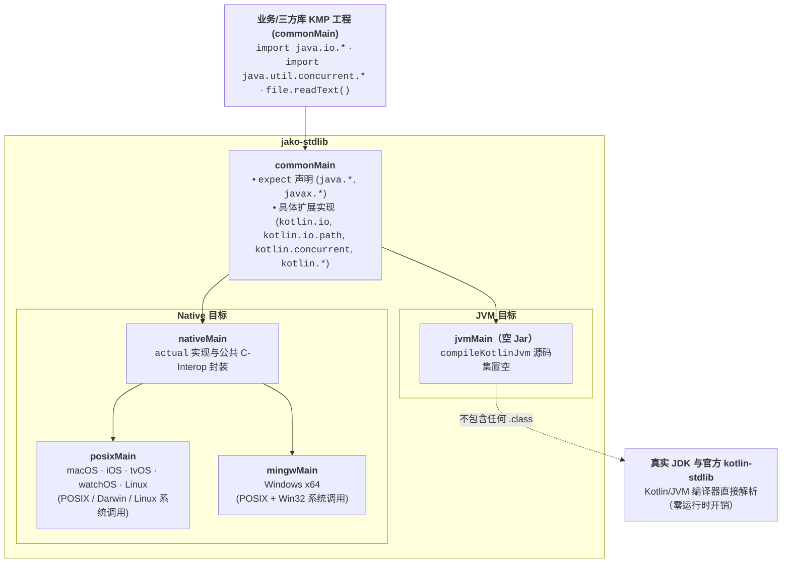

# jako

[English](README.md) | [中文](README_zh.md)

**jako** 是一个开源项目，致力于将 **Java 8 标准库 API** 移植到 Kotlin Multiplatform（JVM & Native）。

在 Kotlin Multiplatform Native 目标平台上，Java 开发者熟悉的 `java.*` 标准库（如 `java.io.File`）无法使用。`jako` 通过在 Native 端提供 C-Interop（POSIX / Win32）实现来弥补这一缺口——所有实现都使用真正的 `java.*` 包名——因此现有的 JVM 库无需修改任何 import 语句即可在 Kotlin Native 上编译运行。

---

## 🌟 核心特性与设计原则

1. **与 Java 8 100% 行为一致**
   - 严格以 Java 8 API 为基线（不包含 Java 9+ 的 API）。
   - 统一在 `commonTest` 中编写测试。执行 `./gradlew check` 时：
     - `jvmTest`：使用真正的 **JDK 8** 执行测试（JVM 端 `compileKotlinJvm` 无源码，直接使用 JDK 类）。
     - `nativeTest`：使用 **Kotlin Native** 的 C-interop 实现执行相同测试。
     - 两个平台都通过即保证 Native 实现与 JDK 8 行为完全一致。

2. **JVM 零开销（空 `jvmJar`）**
   - `jako` 在 `commonMain` 中声明 `java.*` 与 `kotlin.*` API 供 KMP 元数据与 Native 编译使用，同时将 `compileKotlinJvm` 的源码集设为空（`setSource(emptyList())`）。
   - 在 JVM 上，Kotlin 编译器自动将所有 `java.*` 与 `kotlin.*` 解析为真正的 JDK 类与官方 `kotlin-stdlib`，最终生成的 `jvmJar` **不包含任何 `.class` 字节码文件**——零运行时开销，零间接调用，零 Classpath 污染。

3. **跨平台 Native 支持（POSIX & Win32）**
   - 支持 macOS（`arm64`、`x64`）、iOS（`arm64`、`x64`、`simulatorArm64`）、tvOS、watchOS、Linux（`x64`、`arm64`）和 Windows（`mingwX64`）。
   - 使用 `memScoped` 严格管理 C 内存，映射 POSIX `errno` / Win32 错误码。

4. **显式的可空性决策**
   - 为 Java 平台类型（`T!`）到 Kotlin 显式类型（`T` vs `T?`）的映射提供清晰的决策和文档。

5. **原生 Kotlin-stdlib 扩展支持（零导包对齐）**
   - Kotlin 标准库在 Java 类型上的扩展（`kotlin.io`、`kotlin.io.path`、`kotlin.concurrent`、`kotlin.collections`、`kotlin.jvm.optionals` 以及 `kotlin` 中的操作符重载）全部作为具体函数直接在 `commonMain` 中实现。
   - 零导包开销：标准默认导入（如 `kotlin.io`）在 JVM 与 Native 上体验完全一致。

---

## 🚀 快速接入

在 `build.gradle.kts` 的 `commonMain` 依赖中添加 `jako-stdlib`：

```kotlin
kotlin {
    sourceSets {
        commonMain.dependencies {
            implementation("com.bennyhuo.jako:jako-stdlib:1.0.0")
        }
    }
}
```

---

## 🎯 现状与覆盖度

- **零依赖独立标准库**：`jako-stdlib` 作为独立的零依赖多平台库发布。
- **以包名为维度的清单追踪**：所有已移植的 Java 8 核心包及 Kotlin-stdlib 扩展均在 [`API_CHECKLIST.md`](API_CHECKLIST.md) 中登记追踪。
- **100% 行为与签名一致**：通过双平台行为单测（`commonTest`）与自动化 JDK 反射签名检查（`JdkSignatureParityTest`）保证与真实 JDK 行为和继承结构一致。

| 层级 | 组件 | 状态 |
|:---|:---|:---|
| **jako-stdlib** | 核心 `java.*` / `javax.*` API Native 实现 | ✅ 已完成 254 个类与接口，详情见 [`API_CHECKLIST.md`](API_CHECKLIST.md) |
| **Kotlin 扩展** | Java API 的官方 `kotlin.*` 扩展支持 | ✅ 直接在 `commonMain` 的官方 `kotlin.*` 包下提供具体实现 |
| **sample** | 独立 Gradle KMP 示例工程 | ✅ 通过 `includeBuild("../")` 依赖 `jako-stdlib`，展示跨平台实际使用场景 |

---

## 🏗️ 架构



公开 Java API 在 `commonMain` 用 `expect` 声明。`compileKotlinJvm` 源码集设为空，因此 `jvmJar` 不包含任何编译产物，JVM 端直接解析到真实 JDK 与官方 `kotlin-stdlib`。Native 在同样的 `java.*` 包下提供对应的 `actual` 实现。Kotlin-stdlib 扩展函数（如 `File.readText()`、`Path / "child"`、`Lock.withLock`）直接作为具体函数在 `commonMain` 的官方 `kotlin.*` 包下实现。

---

## 🛠️ 构建与测试

### 环境要求
- JDK 17+（用于 Gradle 构建）
- Kotlin Multiplatform 交叉编译工具链

### 运行所有测试
```bash
# 在 JVM 和支持的 Native 目标上构建并运行测试
./gradlew check
```

---

## 📄 许可证

[MIT License](LICENSE)

